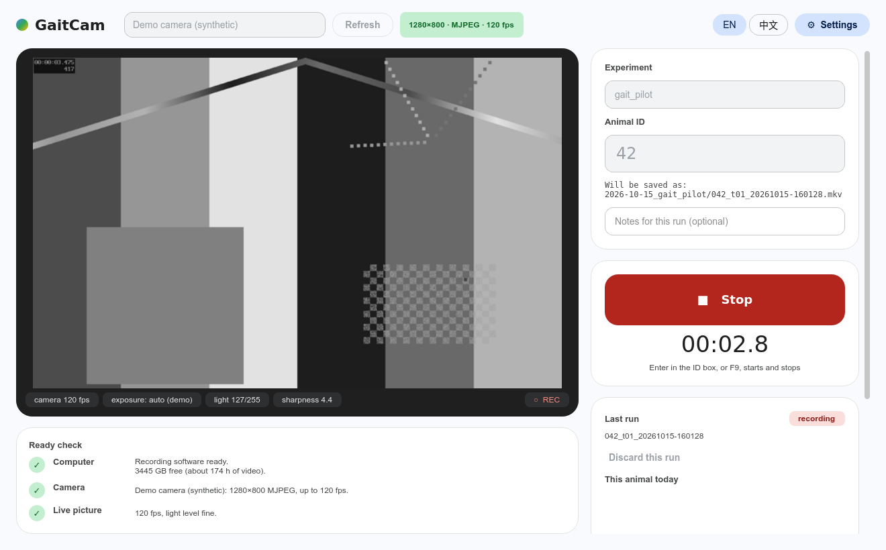

# GaitCam

A one-window recorder for high-speed gait videos (e.g. a mouse walking over a glass walkway, filmed from below).
GaitCam records a USB (UVC) camera's own **MJPEG stream without re-encoding**: no CPU load and no quality loss.
It checks every trial for dropped frames, then names and files everything automatically.



* **Any UVC camera with an MJPEG mode.** You pick the picture size and frame rate from the modes the camera itself
  reports. GaitCam was developed with an Arducam OV9281 global-shutter camera at 1280×800 and 120 fps.
* **Quality check after every trial.** It measures the real frame rate, counts dropped frames from the per-frame
  timestamps, and detects automatic exposure that is still settling. Each trial is marked ✓ good, ⚠ check or ✗ redo.
* **Ready check before recording.** It checks the computer (disk space, data folder, OneDrive), the camera (found, mode
  available, exposure) and the live picture (real frame rate, too dark / too bright).
* **Automatic file names and logs.** Files are organised in one folder per day and experiment. Each trial gets an
  `animal_tNN_time.mkv` video, a JSON sidecar with the settings and QC, and a row in `trials.csv`.
  Files are never overwritten, and a discarded trial is moved to `_rejected/`, never deleted.
* **Crash-safe.** A recording interrupted by a crash or a power cut is finished and checked at the next start.
* **Printable calibration targets**: a ChArUco lens board and floor strips, for wide-angle lenses.
* English / 中文 interface. A demo mode with a synthetic camera lets you try everything without hardware.

## Install (Windows 10 / 11)

1. Download `GaitCam-win64-<version>.zip` from the [Releases](https://github.com/shuyang-zhao/GaitCam/releases) page.
2. **Before unzipping**: right-click the zip → *Properties* → tick **Unblock** → OK.
   Windows marks downloaded files, and unblocking stops the "Are you sure you want to run this?" prompts.
3. Unzip anywhere on a **local** drive, e.g. `C:\GaitCam`. The portable bundle needs no installer, writes nothing
   to the registry and never goes online. To uninstall, delete the folder.
4. Double-click **`GaitCam.bat`**. Optionally, right-click it → *Send to → Desktop (create shortcut)*.

`GaitCam (demo, no camera).bat` runs the same app with a synthetic camera.

### Run from source (any OS)

```bash
pip install -r requirements.txt        # PySide6, numpy, OpenCV
python app/main.py --demo              # ffmpeg and ffprobe must be on PATH
```

Recording from a real camera uses DirectShow on Windows, which is the tested path. On Linux it uses V4L2, which is
implemented but has only been run with the demo camera.

## Daily use

1. Plug the camera **directly** into the PC, not through a hub. Pick it in the camera list at the top. The pill
   next to it shows the active mode, e.g. `1280×800 · MJPEG · 120 fps`.
2. **Experiment**: a short name, e.g. `gait_pilot`. It is kept from last time.
3. **Animal**: type the ID and press **Enter** (or the red **Record** button) to start. Press Enter, F9 or **Stop**
   to finish. One trial = one run along the walkway.
4. After each trial a badge appears:
   * **✓ good**: nothing to do.
   * **⚠ check**: a few frames were lost. The trial is usable, but see *Troubleshooting*.
   * **✗ redo**: record that run again. *Discard this run* moves the trial to `_rejected/`.
5. Once per session, and whenever the camera is moved: put the floor calibration strips (or a ruler) on the walkway
   and click **Record a 1-s calibration clip**.

### Where the files go

```
Documents\GaitCam\                      (change in Settings → Data folder; prefer a local, non-OneDrive drive)
  2026-10-12_gait_pilot\                one folder per day + experiment
    042_t01_20261012-141503.mkv         animal 042, trial 1, start time
    042_t01_20261012-141503.json        settings + quality check for that trial
    trials.csv                          one row per trial (rebuilt automatically)
    calib\calib_t01_….mkv               calibration clips
    _rejected\…                         discarded trials
```

Numeric IDs are zero-padded (`42` → `042`). Spaces and symbols are removed. Trial numbers continue automatically,
also after restarting the app.

## Settings (gear button)

* **Picture size**: the MJPEG modes the camera reports, each with its maximum frame rate.
* **Frame rate**: the camera's maximum for that size comes first, followed by common lower rates. Stay at the
  maximum unless trials keep failing the frame check.
* **Exposure**: 0.5–8 ms. Only exposures shorter than one frame are offered (at 240 fps: up to 4 ms). A shorter
  exposure gives sharper paws but a darker picture. 1–2 ms with a bright light is ideal.
* **Data folder**.
* **Camera's own settings window**: the driver's property page, as a fallback for anything GaitCam does not expose.

### Higher frame rates

GaitCam records any rate the camera offers in MJPEG, and the QC, exposure limits and disk-space estimate adapt to it.
The frame rate itself is a property of the camera:

* The Arducam OV9281 UVC module tops out at 100–120 fps depending on firmware, also at smaller picture sizes.
  For faster video, use a camera whose MJPEG mode list goes higher.
* Faster means less light per frame. Use a short exposure and a bright **DC-powered** (flicker-free) LED light.
* Plug the camera into a rear USB port of its own, since a full USB 2.0 bus drops frames.
* The Matroska timestamps have 1 ms resolution, so the dropped-frame check stays reliable up to about 500 fps.

## Camera calibration (wide-angle lens)

The **Calibration targets to print (PDF)…** button in the app opens the `calibration/` folder. Print
`GaitCam_calibration_Letter.pdf` or `GaitCam_calibration_A4.pdf` at **100 % / Actual size** and follow page 1:

* **Lens board** (page 2, ChArUco). Record it once per camera, lens and focus setting: use animal ID `LENS`, record
  about 60 s, and move and tilt the board over the whole picture with the walkway floor removed.
* **Floor strips** (page 3). Lay them printed side down on the walkway floor, and capture them with *Record a 1-s
  calibration clip* whenever the camera or the walkway moves.

Every target page carries a 100 mm bar, so you can check that the printer did not scale the page.
`calibration/make_targets.py` regenerates the PDFs, and `calibration/check_targets.py` verifies them.

## Troubleshooting

| Symptom | Fix |
|---|---|
| "No camera found" | Plug the camera directly into the PC and click Refresh. Close other camera apps (video calls, other recorders). |
| "This camera has no MJPEG mode" | GaitCam stores the camera's MJPEG stream as it is, so the camera needs an MJPEG mode. |
| "No … MJPEG mode" / "tops out at … fps" | Choose another picture size or frame rate in Settings. Some firmware versions are slower. |
| ⚠ / ✗ with fewer fps than requested | The exposure is too long for the frame rate, the image is too dark (many cameras then slow down), or the camera is on a USB hub / front-panel port. Use a rear USB port. |
| Image flickers / brightness pulses | Mains-powered lamps flicker at 100/120 Hz. Use a DC-powered (flicker-free) LED light. |
| "light … too dark / too bright" chip | Adjust the lamp first and the exposure second. |
| ⚠ "The picture got brighter during the first half-second" | The camera's automatic exposure / gain is still on. Settings → *camera's own settings window* → untick **Auto** next to Exposure (and Gain), then record again. |

Diagnostics are written to `gaitcam.log`. Its location is shown in Settings.

## Known limitations

* **Exposure lock.** GaitCam sets manual exposure through DirectShow before ffmpeg opens the camera. On the tested
  camera this did not always stop the automatic exposure / gain. The per-trial check flags it (⚠ brightness ramp),
  and unticking *Auto* in the camera's own settings window fixes it.
* Recording from real cameras has been tested on Windows only.

## Development

See [docs/DEVELOPMENT.md](docs/DEVELOPMENT.md) for the code layout, design notes, tests and how the Windows bundle
is built.

## Citing GaitCam

If GaitCam helps your research, please cite it. See [`CITATION.cff`](CITATION.cff) or GitHub's *Cite this repository*
button.

## License

GaitCam is released under the [MIT License](LICENSE). The Windows bundle includes third-party components (Python,
FFmpeg, Qt / PySide6, NumPy, OpenCV) under their own licenses. See
[THIRD_PARTY_NOTICES.md](THIRD_PARTY_NOTICES.md).
